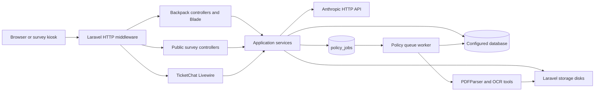
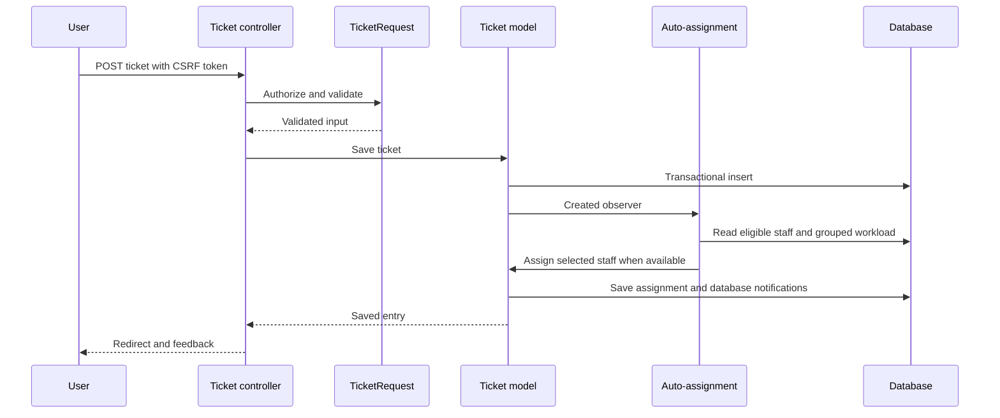

# 02 - System Architecture

## Architecture and ownership

EmployeeCare is a Laravel MVC monolith with Backpack CRUD, server-rendered Blade, Livewire discussion, JSON/AJAX actions and a small service layer. Database and filesystem state both participate in ticket/policy workflows. No separate frontend SPA, microservice architecture or deployed WebSocket service is evidenced.

| Component | Responsibility | Source |
| --- | --- | --- |
| HTTP entry/bootstrap | Application and container initialization | [public/index.php](../public/index.php), [bootstrap/app.php](../bootstrap/app.php) |
| Middleware/providers | Sessions, CSRF, bindings, active panel membership and rate budgets | [Kernel](../app/Http/Kernel.php), [route provider](../app/Providers/RouteServiceProvider.php), [panel middleware](../app/Http/Middleware/CheckIfAdmin.php) |
| Backpack controllers | CRUD configuration, operation gates, custom ticket actions | [controller inventory](IMPLEMENTATION-INVENTORY.md) |
| Models | Relationships, casting, visibility and ticket lifecycle hooks | [Ticket](../app/Models/Ticket.php), [User](../app/Models/User.php) |
| Ticket services | Eligibility, automatic selection, notifications, reports | [assignment rules](../app/Services/TicketAssignmentRules.php), [auto-assignment](../app/Services/TicketAutoAssignmentService.php), [notifications](../app/Services/TicketNotificationService.php) |
| Attachment services | Writes, compensation, reference inventory and transaction tracking | [storage](../app/Services/AttachmentStorage.php), [transactions](../app/Services/AttachmentTransactions.php), [inventory](../app/Services/AttachmentInventory.php) |
| Policy services/job | Extraction, chunking, retrieval, prompt boundaries and provider calls | [ingestion](../app/Services/PolicyIngestService.php), [OCR](../app/Services/OcrService.php), [job](../app/Jobs/IngestPolicyDocumentJob.php), [retriever](../app/Services/PolicyRetriever.php) |
| Report services | Period resolution, SQL dialects, aggregates, paged survey data | [period](../app/Services/ReportPeriodResolver.php), [query service](../app/Services/TicketReportQueries.php), [survey queries](../app/Services/SurveyReportQueries.php), [table](../app/Services/SurveyResponseTable.php) |

## Request lifecycle

The public front controller boots Laravel. Global middleware validates request size, trims input, normalizes empty values and applies CORS/proxy behavior. `web` adds cookies, session, CSRF and bindings. The Backpack `admin` alias checks active authenticated membership, including employees; it does not mean administrator role. Controllers/components then enforce permissions and record visibility. A request may return HTML, redirect/flash, JSON, a streamed PDF or a protected file response.

The divisions lookup is declared outside the protected route groups and has no declared route middleware in the isolated registration snapshot. `/api/user` belongs to the Laravel API group and uses `auth:sanctum`. See [route reference](07-ROUTES-AND-API.md).

## Ticket lifecycle and events

`Ticket::save()` wraps persistence in a database transaction, retries recognized reference collisions and tracks staged attachments. Model hooks derive catalog routing/priority, maintain timestamps, arrange after-commit file deletion and send notifications. `EventServiceProvider` registers `TicketObserver`; its `created` callback invokes automatic assignment when no assignee is present. This service synchronizes original attributes before the nested save to avoid SQL Server identity-column updates.

No event-sourced ticket history is implemented. Reassignment records are dedicated workflow data; log messages and notifications are not a complete immutable audit record.

## Authentication and authorization

The configured guard is `web` with the Eloquent `User` provider. Spatie roles/permissions are stored separately from the legacy `users.role` number. `AuthServiceProvider` has no active policy mapping. CRUD operation gates, `Ticket::visibleTo()`, `TicketAssignmentRules`, report-controller middleware, policy-manager role checks and Livewire checks jointly determine access.

Login accepts email or username and requires active status. Outside `local`, the login-page action redirects to an external HRDO login; the actual external authentication/session contract is **Not Verified**. Existing-session redirect includes a hardcoded application path. Registration availability is configuration/environment dependent and custom account creation does not assign a Spatie role.

Sources: [auth config](../config/auth.php), [Backpack config](../config/backpack/base.php), [login](../app/Http/Controllers/Admin/Auth/LoginController.php), [registration](../app/Http/Controllers/Admin/Auth/RegisterController.php), [auth provider](../app/Providers/AuthServiceProvider.php).

## Storage architecture

- `ticket_attachments`: private root `storage/app/ticket-attachments`; relative `attachments/...` strings remain in ticket/comment JSON arrays. Authorized routes resolve stored indices rather than accepting an arbitrary path.
- `public`: avatars and transitional legacy ticket files under `storage/app/public`; `public/storage` is the configured link. Apache rules deny direct legacy attachment URLs. Other servers need equivalent rules.
- Default filesystem, normally `local`: policy PDFs in `policies/...`; OCR temporary work is controlled by `OcrService`.
- Repository `public/policyDocs` content is a separate static-public exposure surface; its intended distribution/classification is **Not Verified**. Do not assume it is the private upload store.

## Notifications and external integrations

`TicketSystemNotification::via()` returns only `database`; it does not implement `ShouldQueue`. `TicketNotificationService` filters candidates, actor exclusions and preference flags. Browser feeds poll database notifications. Mail configuration exists for framework/package paths such as recovery, but delivered email was not tested.

The selected policy provider is `AnthropicService`, called only after retrieval finds eligible context. Gemini and OpenRouter service implementations are present but not automatically selected or used as failover. HTTP timeouts and bounded context/history exist; successful external model access is **Not Verified**. PDF reports use Dompdf; QR generation uses Simple QrCode.

`EventServiceProvider` maps login to `UpdateLastLoginAt`; registered-user email-verification listener configuration does not prove enforced verification. `BroadcastServiceProvider`/channel declarations are not evidence of real-time ticket broadcasting. `Console\Kernel::schedule()` contains no active schedule.

For detailed flows and ER diagrams see [consolidated diagrams](DIAGRAMS.md); operations are in [deployment and maintenance](09-DEPLOYMENT-AND-MAINTENANCE.md).

## Error handling and configuration boundaries

[Handler](../app/Exceptions/Handler.php) retains Laravel exception handling and excludes current_password/password/password_confirmation from flashed input. Custom policy setup/dispatch/chat exceptions carry bounded user-facing failure contracts; attachment inspection exceptions support conservative operator failure handling. Controllers catch selected provider/storage/PDF errors and log operational context, while ordinary model/validation exceptions use Laravel responses. Exception handling is not a complete redaction or availability guarantee.

Application timezone defaults to UTC in [config/app.php](../config/app.php), independent of the workstation user timezone. Configuration includes a separate SQL Server connectsession definition, but no active application consumer was found in the inspected app sources; do not infer a working SSO/session synchronization implementation from that connection alone.
