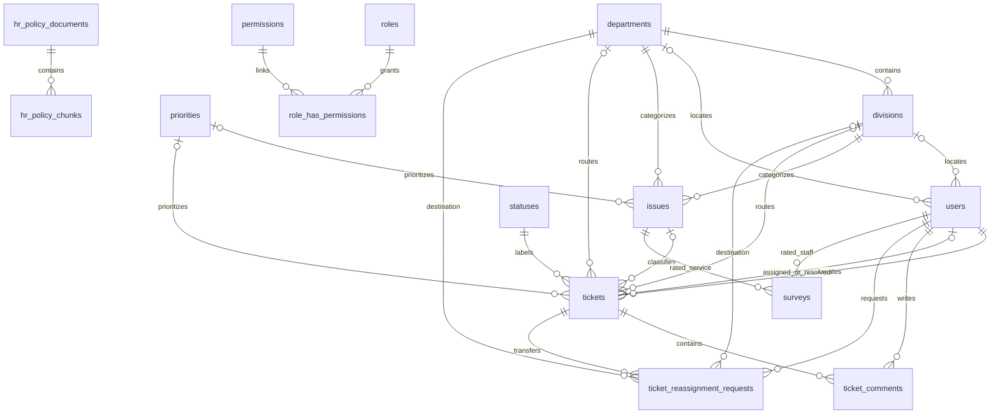
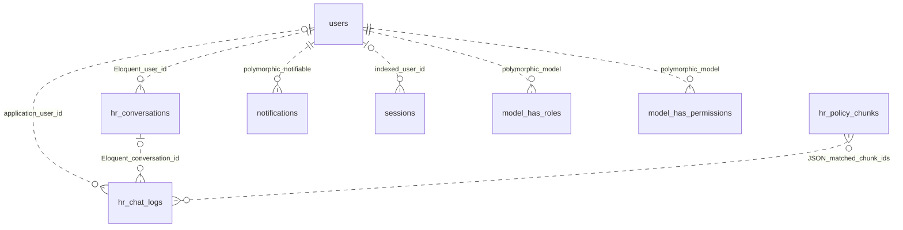

# 03 - Database Documentation

## Scope and interpretation

This is a **migration-derived schema**, not an inspection of deployed tables. There are 33 repository migrations. Laravel's migration repository adds its own `migrations` table when migrations are installed. Actual database version, applied migration list, collation, indexes and drift are **Not Verified**.

The default connection in [config/database.php](../config/database.php) is MySQL; SQL Server is also configured and explicitly handled in migrations/services. Unsigned types, JSON, UUID and timestamp definitions below use Laravel Blueprint terminology; physical SQL types vary by driver. SQL Server attachment columns are explicitly `NVARCHAR(MAX)` after the widening/Unicode migrations. A successful SQLite test is not SQL Server/MySQL certification.

## Table catalog

`id()` means an auto-incrementing bigint primary key; `timestamps()` means nullable `created_at` and `updated_at` timestamps. String lengths default to Laravel's schema default where not specified. See the exact declarations below for nullability, defaults, uniqueness and engine conditions.

| Table | Purpose and important fields | Integrity notes |
| --- | --- | --- |
| `departments` | Department name and timestamps | PK id; name uniqueness is request validation, not a declared unique index |
| `divisions` | Division name, department_id | FK to departments; no compound name uniqueness |
| `priorities` | priority_name, priority_color | PK id; High/Medium/Low are seeded labels |
| `statuses` | status_name, status_color | PK id; request-level name uniqueness; required lifecycle names are seeded |
| `issues` | Department, division, nullable priority, description and optional icon | FKs to organization/priority; application enforces division membership |
| `users` | Employee number, legacy role number, name/nickname, unique nullable username/email, nullable department/division, active flag, avatar, password, skills JSON, login/verification timestamps, notification flags, remember token | Department/division FKs; emp_no not unique; Spatie roles are authoritative for role checks |
| `tickets` | Unique reference_id; creator, destination, status, optional issue/custom issue/priority; message; attachment array; resolution/reopen fields; assignee/resolver | FKs to users, departments, divisions, statuses, issues and priorities; attachment array is JSON encoded in text, not a child table |
| `ticket_comments` | ticket_id, user_id, comment and nullable attachment array | Ticket/user FKs; application deletes comments individually for file cleanup |
| `ticket_reassignment_requests` | Ticket, from/to department/division, requester, reason, status, responder, response time/note | Ticket FK cascades; organization/user FKs; no unique constraint declaring one pending transfer |
| `surveys` | Rated staff user_id, service issue_id, four rating strings, nullable unique submission_id | Staff/service FKs; user_id is rated staff, not respondent identity; no migration creates submission_date |
| `arta_surveys` | Optional client_type, sex, age, numeric region, service; CC1-CC3 and SQD0-SQD8; nullable unique submission_id | Region is a numeric choice, not an FK to a regions table |
| `hr_policy_documents` | Title, original filename, stored path, category, active flag, effective date, state, chunk count/error, OCR flag/confidence, hash, extracted page JSON, ingestion version/times | file_hash has a nonunique index; metadata/state gate retrieval |
| `hr_policy_chunks` | document_id, chunk index, optional page/section, content and search_vector text | FK to document; composite document/chunk index is not unique; no full-text/vector index declared |
| `hr_conversations` | user_id, optional title, star flag, last_message_at, timestamps | user_id has no FK; composite sidebar index |
| `hr_chat_logs` | Nullable user_id/conversation_id/session_id; question bounded to 600 chars, answer, matched_chunk_ids JSON, feedback, timestamps | No user/conversation FK; matched chunk IDs are application references, not FK-enforced |
| `notifications` | UUID PK, notification type, polymorphic notifiable fields, data text, read_at, timestamps | Polymorphic composite index; no user FK |
| `sessions` | String PK, nullable indexed user_id, IP, user agent, payload, indexed last_activity | user_id is not constrained despite foreignId declaration |
| `roles`, `permissions` | id, name, guard_name, timestamps | Unique name/guard; configured permission teams disabled by default |
| `model_has_roles`, `model_has_permissions` | Role/permission FK plus model_type/model_id | Composite PK and morph index; model_id has no users FK |
| `role_has_permissions` | permission_id and role_id | Both FKs; composite PK |
| `personal_access_tokens` | Polymorphic owner, token name, unique 64-char token, optional abilities/last_used_at | Morph index; no owner FK |
| `password_resets` | Indexed email, token, nullable created_at | No PK or user FK declared |
| `failed_jobs` | id, unique uuid, connection, queue, payload, exception, failed_at | Failed-job infrastructure; payload/exception may be sensitive |
| `policy_jobs` | id, indexed queue, payload, attempts, reserved_at, available_at, created_at | Database queue Unix-time integer fields; reserved_at nullable |

## Relationships and data flow

Catalog issue selection supplies ticket destination and priority. Ticket ownership, assignment and organizational scope determine visibility. Comments belong to a ticket and author. A transfer retains from/to organization and responding actors; accepting it changes the ticket location and reruns assignment. Satisfaction responses reference staff and service, independently of tickets. ARTA responses are standalone records.

Policy documents own extracted chunks. Retrieval selects active documents; chat logs store chunk IDs and conversation IDs. Conversation deletion explicitly deletes logs because the database does not cascade those relationships. Document service explicitly deletes chunks before document deletion.

### Foreign-key-enforced relationships



This diagram is a readable subset; the source declarations below additionally define from/to and responder FKs. Multiplicity describes nullable foreign keys, not mandatory existence of child rows.

### Application-only relationships



Dotted edges here mean no corresponding database FK, not weak authorization. See [model sources](IMPLEMENTATION-INVENTORY.md). `Region` has a model but no migration-created `regions` table or verified module. `Survey::$fillable` includes `submission_date`, absent from the migrations.

## Indexes and schema evolution

- Tickets: unique reference; explicit indexes on status, creator, assignee, creation time, issue, department/division and department/division/status.
- Users: unique nullable username/email and explicit department/division index. FK-generated indexes are driver-dependent.
- Transfers: ticket/status, destination department and destination division indexes.
- Policy documents: file hash index. Chunks: document/chunk index.
- Conversations: user/star/recent index. Logs: user/session/id and conversation/id indexes.
- Surveys/ARTA: unique submission_id; SQL Server uses a filtered index `WHERE submission_id IS NOT NULL` to permit legacy nulls.
- Permission tables: composite keys and morph indexes as shown below; optional teams branch depends on config.
- General queue config references `jobs`, but no repository migration creates a generic `jobs` table. Policy ingestion uses the migrated `policy_jobs` table.

Widening attachment fields, bounding the question column and adding ingestion markers change storage requirements. The question-bound migration narrows the column without an explicit truncation/backfill step; overlong legacy values need engine-specific review. Conversation backfill groups historical logs. Review and back up data before applying. Do not edit already-applied migrations to reconcile a live schema.

## Migration declarations and lineage

The following excerpts are taken from each migration's `up()` body, with explanatory comments removed for readability. They preserve actual types, lengths, constraints, names and conditional engine branches. They are source reference, **not SQL to paste into a database**. See the linked migration for rollback and full implementation.


### 2014_10_12_100000_create_password_resets_table

Source: [2014_10_12_100000_create_password_resets_table.php](../database/migrations/2014_10_12_100000_create_password_resets_table.php).

```php
Schema::create('password_resets', function (Blueprint $table) {
    $table->string('email')->index();
    $table->string('token');
    $table->timestamp('created_at')->nullable();
});
```


### 2019_08_19_000000_create_failed_jobs_table

Source: [2019_08_19_000000_create_failed_jobs_table.php](../database/migrations/2019_08_19_000000_create_failed_jobs_table.php).

```php
Schema::create('failed_jobs', function (Blueprint $table) {
    $table->id();
    $table->string('uuid')->unique();
    $table->text('connection');
    $table->text('queue');
    $table->longText('payload');
    $table->longText('exception');
    $table->timestamp('failed_at')->useCurrent();
});
```


### 2019_12_14_000001_create_personal_access_tokens_table

Source: [2019_12_14_000001_create_personal_access_tokens_table.php](../database/migrations/2019_12_14_000001_create_personal_access_tokens_table.php).

```php
Schema::create('personal_access_tokens', function (Blueprint $table) {
    $table->id();
    $table->morphs('tokenable');
    $table->string('name');
    $table->string('token', 64)->unique();
    $table->text('abilities')->nullable();
    $table->timestamp('last_used_at')->nullable();
    $table->timestamps();
});
```


### 2020_03_31_114745_remove_backpackuser_model

Source: [2020_03_31_114745_remove_backpackuser_model.php](../database/migrations/2020_03_31_114745_remove_backpackuser_model.php).

```php
$model_has_roles = config('permission.table_names.model_has_roles');
$model_has_permissions = config('permission.table_names.model_has_permissions');
if (\Illuminate\Support\Facades\Schema::hasTable($model_has_roles)) {
    $this->replaceModels($model_has_roles);
}
if (\Illuminate\Support\Facades\Schema::hasTable($model_has_permissions)) {
    $this->replaceModels($model_has_permissions);
}
```


### 2026_02_23_070500_create_permission_tables

Source: [2026_02_23_070500_create_permission_tables.php](../database/migrations/2026_02_23_070500_create_permission_tables.php).

```php
$tableNames = config('permission.table_names');
$columnNames = config('permission.column_names');
$teams = config('permission.teams');
if (empty($tableNames)) {
    throw new \Exception('Error: config/permission.php not loaded. Run [php artisan config:clear] and try again.');
}
if ($teams && empty($columnNames['team_foreign_key'] ?? null)) {
    throw new \Exception('Error: team_foreign_key on config/permission.php not loaded. Run [php artisan config:clear] and try again.');
}
Schema::create($tableNames['permissions'], function (Blueprint $table) {
    $table->bigIncrements('id'); // permission id
    $table->string('name');       // For MySQL 8.0 use string('name', 125);
    $table->string('guard_name'); // For MySQL 8.0 use string('guard_name', 125);
    $table->timestamps();
    $table->unique(['name', 'guard_name']);
});
Schema::create($tableNames['roles'], function (Blueprint $table) use ($teams, $columnNames) {
    $table->bigIncrements('id'); // role id
    if ($teams || config('permission.testing')) { // permission.testing is a fix for sqlite testing
        $table->unsignedBigInteger($columnNames['team_foreign_key'])->nullable();
        $table->index($columnNames['team_foreign_key'], 'roles_team_foreign_key_index');
    }
    $table->string('name');       // For MySQL 8.0 use string('name', 125);
    $table->string('guard_name'); // For MySQL 8.0 use string('guard_name', 125);
    $table->timestamps();
    if ($teams || config('permission.testing')) {
        $table->unique([$columnNames['team_foreign_key'], 'name', 'guard_name']);
    } else {
        $table->unique(['name', 'guard_name']);
    }
});
Schema::create($tableNames['model_has_permissions'], function (Blueprint $table) use ($tableNames, $columnNames, $teams) {
    $table->unsignedBigInteger(PermissionRegistrar::$pivotPermission);
    $table->string('model_type');
    $table->unsignedBigInteger($columnNames['model_morph_key']);
    $table->index([$columnNames['model_morph_key'], 'model_type'], 'model_has_permissions_model_id_model_type_index');
    $table->foreign(PermissionRegistrar::$pivotPermission)
        ->references('id') // permission id
        ->on($tableNames['permissions']);
    if ($teams) {
        $table->unsignedBigInteger($columnNames['team_foreign_key']);
        $table->index($columnNames['team_foreign_key'], 'model_has_permissions_team_foreign_key_index');
        $table->primary([$columnNames['team_foreign_key'], PermissionRegistrar::$pivotPermission, $columnNames['model_morph_key'], 'model_type'],
            'model_has_permissions_permission_model_type_primary');
    } else {
        $table->primary([PermissionRegistrar::$pivotPermission, $columnNames['model_morph_key'], 'model_type'],
            'model_has_permissions_permission_model_type_primary');
    }
});
Schema::create($tableNames['model_has_roles'], function (Blueprint $table) use ($tableNames, $columnNames, $teams) {
    $table->unsignedBigInteger(PermissionRegistrar::$pivotRole);
    $table->string('model_type');
    $table->unsignedBigInteger($columnNames['model_morph_key']);
    $table->index([$columnNames['model_morph_key'], 'model_type'], 'model_has_roles_model_id_model_type_index');
    $table->foreign(PermissionRegistrar::$pivotRole)
        ->references('id') // role id
        ->on($tableNames['roles']);
    if ($teams) {
        $table->unsignedBigInteger($columnNames['team_foreign_key']);
        $table->index($columnNames['team_foreign_key'], 'model_has_roles_team_foreign_key_index');
        $table->primary([$columnNames['team_foreign_key'], PermissionRegistrar::$pivotRole, $columnNames['model_morph_key'], 'model_type'],
            'model_has_roles_role_model_type_primary');
    } else {
        $table->primary([PermissionRegistrar::$pivotRole, $columnNames['model_morph_key'], 'model_type'],
            'model_has_roles_role_model_type_primary');
    }
});
Schema::create($tableNames['role_has_permissions'], function (Blueprint $table) use ($tableNames) {
    $table->unsignedBigInteger(PermissionRegistrar::$pivotPermission);
    $table->unsignedBigInteger(PermissionRegistrar::$pivotRole);
    $table->foreign(PermissionRegistrar::$pivotPermission)
        ->references('id') // permission id
        ->on($tableNames['permissions']);
    $table->foreign(PermissionRegistrar::$pivotRole)
        ->references('id') // role id
        ->on($tableNames['roles']);
    $table->primary([PermissionRegistrar::$pivotPermission, PermissionRegistrar::$pivotRole], 'role_has_permissions_permission_id_role_id_primary');
});
app('cache')
    ->store(config('permission.cache.store') != 'default' ? config('permission.cache.store') : null)
    ->forget(config('permission.cache.key'));
```


### 2026_02_24_022107_create_priorities_table

Source: [2026_02_24_022107_create_priorities_table.php](../database/migrations/2026_02_24_022107_create_priorities_table.php).

```php
Schema::create('priorities', function (Blueprint $table) {
    $table->id();
    $table->string('priority_name');
    $table->string('priority_color');
    $table->timestamps();
});
```


### 2026_02_24_022453_create_departments_table

Source: [2026_02_24_022453_create_departments_table.php](../database/migrations/2026_02_24_022453_create_departments_table.php).

```php
Schema::create('departments', function (Blueprint $table) {
    $table->id();
    $table->string('department_name');
    $table->timestamps();
});
```


### 2026_02_24_022509_create_divisions_table

Source: [2026_02_24_022509_create_divisions_table.php](../database/migrations/2026_02_24_022509_create_divisions_table.php).

```php
Schema::create('divisions', function (Blueprint $table) {
    $table->id();
    $table->string('division_name');
    $table->foreignId('department_id')->constrained();
    $table->timestamps();
});
```


### 2026_02_24_022528_create_issues_table

Source: [2026_02_24_022528_create_issues_table.php](../database/migrations/2026_02_24_022528_create_issues_table.php).

```php
Schema::create('issues', function (Blueprint $table) {
    $table->id();
    $table->foreignId('department_id')->constrained();
    $table->foreignId('division_id')->constrained();
    $table->foreignId('priority_id')->nullable()->constrained();
    $table->string('issue_description');
    $table->string('icon')->nullable();
    $table->timestamps();
});
```


### 2026_02_24_022530_create_users_table

Source: [2026_02_24_022530_create_users_table.php](../database/migrations/2026_02_24_022530_create_users_table.php).

```php
Schema::create('users', function (Blueprint $table) {
    $table->id();
    $table->string('emp_no')->nullable(); //Add unique() if needed
    $table->unsignedTinyInteger('role')->default(2); // default for "employee" role (1=admin, 2=employee)
    $table->string('name');
    $table->string('nickname')->nullable();
    $table->string('username')->nullable()->unique();
    $table->string('email')->unique()->nullable();
    $table->foreignId('department_id')->nullable()->constrained();
    $table->foreignId('division_id')->nullable()->constrained();
    $table->boolean('is_active')->default(true);
    $table->string('avatar_url')->nullable();
    $table->timestamp('email_verified_at')->nullable();
    $table->string('password');
    $table->json('skills')->nullable();
    $table->timestamp('last_login_at')->nullable();
    $table->boolean('notify_ticket_created')->default(true);
    $table->boolean('notify_ticket_assigned')->default(true);
    $table->boolean('notify_ticket_status_changed')->default(true);
    $table->boolean('notify_ticket_commented')->default(true);
    $table->rememberToken();
    $table->timestamps();
});
```


### 2026_02_24_024606_create_statuses_table

Source: [2026_02_24_024606_create_statuses_table.php](../database/migrations/2026_02_24_024606_create_statuses_table.php).

```php
Schema::create('statuses', function (Blueprint $table) {
    $table->id();
    $table->string('status_name');
    $table->string('status_color');
    $table->timestamps();
});
```


### 2026_02_24_073426_create_tickets_table

Source: [2026_02_24_073426_create_tickets_table.php](../database/migrations/2026_02_24_073426_create_tickets_table.php).

```php
Schema::create('tickets', function (Blueprint $table) {
    $table->id();
    $table->string('reference_id')->unique();
    $table->foreignId('user_id')->constrained();
    $table->foreignId('department_id')->nullable()->constrained();
    $table->foreignId('division_id')->nullable()->constrained();
    $table->foreignId('status_id')->constrained();
    $table->foreignId('issue_id')->nullable()->constrained();
    $table->string('custom_issue')->nullable();
    $table->boolean('is_custom_issue')->default(false);
    $table->foreignId('priority_id')->nullable()->constrained();
    $table->text('message');
    $table->string('attachments')->nullable();
    $table->timestamp('resolved_at')->nullable();
    $table->timestamp('reopened_at')->nullable();
    $table->foreignId('assigned_to')->nullable()->constrained('users');
    $table->foreignId('resolved_by')->nullable()->constrained('users');
    $table->timestamps();
});
```


### 2026_03_05_074049_surveys_table

Source: [2026_03_05_074049_surveys_table.php](../database/migrations/2026_03_05_074049_surveys_table.php).

```php
Schema::create('surveys', function (Blueprint $table) {
    $table->id();
    $table->foreignId('user_id')->constrained('users');
    $table->foreignId('issue_id')->constrained();
    $table->string('timeliness_rating');
    $table->string('handling_rating');
    $table->string('quality_rating');
    $table->string('overall_rating');
    $table->timestamps();
});
```


### 2026_03_11_061811_create_ticket_comments_table

Source: [2026_03_11_061811_create_ticket_comments_table.php](../database/migrations/2026_03_11_061811_create_ticket_comments_table.php).

```php
Schema::create('ticket_comments', function (Blueprint $table) {
    $table->id();
    $table->foreignId('ticket_id')->constrained();
    $table->foreignId('user_id')->constrained();
    $table->text('comment');
    $table->string('attachment')->nullable();
    $table->timestamps();
});
```


### 2026_03_13_080231_create_notifications_table

Source: [2026_03_13_080231_create_notifications_table.php](../database/migrations/2026_03_13_080231_create_notifications_table.php).

```php
Schema::create('notifications', function (Blueprint $table) {
    $table->uuid('id')->primary();
    $table->string('type');
    $table->morphs('notifiable');
    $table->text('data');
    $table->timestamp('read_at')->nullable();
    $table->timestamps();
});
```


### 2026_04_16_021820_create_arta_surveys_table

Source: [2026_04_16_021820_create_arta_surveys_table.php](../database/migrations/2026_04_16_021820_create_arta_surveys_table.php).

```php
Schema::create('arta_surveys', function (Blueprint $table) {
    $table->id();
    $table->string('client_type')->nullable();
    $table->string('sex')->nullable();
    $table->integer('age')->nullable();
    $table->unsignedTinyInteger('region')->nullable();
    $table->string('service_availed')->nullable();
    $table->tinyInteger('cc1')->nullable();
    $table->tinyInteger('cc2')->nullable();
    $table->tinyInteger('cc3')->nullable();
    $table->string('sqd0')->nullable();
    $table->string('sqd1')->nullable();
    $table->string('sqd2')->nullable();
    $table->string('sqd3')->nullable();
    $table->string('sqd4')->nullable();
    $table->string('sqd5')->nullable();
    $table->string('sqd6')->nullable();
    $table->string('sqd7')->nullable();
    $table->string('sqd8')->nullable();
    $table->timestamps();
});
```


### 2026_06_09_011605_create_hr_chatbot_tables

Source: [2026_06_09_011605_create_hr_chatbot_tables.php](../database/migrations/2026_06_09_011605_create_hr_chatbot_tables.php).

```php
Schema::create('hr_policy_documents', function (Blueprint $table) {
    $table->id();
    $table->string('title');
    $table->string('filename');
    $table->string('file_path')->nullable();
    $table->string('category')->default('general'); // leave, benefits, conduct, etc.
    $table->boolean('is_active')->default(true);
    $table->date('effective_date')->nullable();
    $table->string('status')->default('active');
    $table->unsignedInteger('chunk_count')->default(0);
    $table->text('ingest_error')->nullable();
    $table->boolean('ocr_used')->default(false);
    $table->timestamps();
});
Schema::create('hr_policy_chunks', function (Blueprint $table) {
    $table->id();
    $table->foreignId('document_id')->constrained('hr_policy_documents');
    $table->unsignedInteger('chunk_index');
    $table->string('section_title')->nullable();
    $table->text('content');
    $table->text('search_vector')->nullable();
    $table->timestamps();
    $table->index(['document_id', 'chunk_index'], 'hr_policy_chunks_document_chunk_index');
});
Schema::create('hr_chat_logs', function (Blueprint $table) {
    $table->id();
    $table->unsignedBigInteger('user_id')->nullable(); // backpack_user()->id
    $table->text('question');
    $table->longText('answer');
    $table->json('matched_chunk_ids')->nullable();
    $table->tinyInteger('feedback')->nullable(); // 1 = helpful, -1 = not
    $table->timestamps();
});
```


### 2026_06_24_064940_create_sessions_table

Source: [2026_06_24_064940_create_sessions_table.php](../database/migrations/2026_06_24_064940_create_sessions_table.php).

```php
Schema::create('sessions', function (Blueprint $table) {
    $table->string('id')->primary();
    $table->foreignId('user_id')->nullable()->index();
    $table->string('ip_address', 45)->nullable();
    $table->text('user_agent')->nullable();
    $table->text('payload');
    $table->integer('last_activity')->index();
});
```


### 2026_07_13_083609_add_ocr_fields_to_hr_policy_tables

Source: [2026_07_13_083609_add_ocr_fields_to_hr_policy_tables.php](../database/migrations/2026_07_13_083609_add_ocr_fields_to_hr_policy_tables.php).

```php
Schema::table('hr_policy_documents', function (Blueprint $table) {
    $table->string('file_hash', 64)->nullable()->after('file_path');
    $table->longText('extracted_text')->nullable()->after('ingest_error');
    $table->unsignedTinyInteger('ocr_confidence')->nullable()->after('ocr_used');
    $table->index('file_hash', 'hr_policy_documents_file_hash_index');
});
Schema::table('hr_policy_chunks', function (Blueprint $table) {
    $table->unsignedInteger('page_number')->nullable()->after('chunk_index');
});
```


### 2026_07_15_090000_create_ticket_reassignment_requests_table

Source: [2026_07_15_090000_create_ticket_reassignment_requests_table.php](../database/migrations/2026_07_15_090000_create_ticket_reassignment_requests_table.php).

```php
Schema::create('ticket_reassignment_requests', function (Blueprint $table) {
    $table->id();
    $table->foreignId('ticket_id')->constrained()->cascadeOnDelete();
    $table->foreignId('from_department_id')->nullable()->constrained('departments');
    $table->foreignId('from_division_id')->nullable()->constrained('divisions');
    $table->foreignId('to_department_id')->constrained('departments');
    $table->foreignId('to_division_id')->nullable()->constrained('divisions');
    $table->foreignId('requested_by')->constrained('users');
    $table->text('reason')->nullable();
    $table->string('status')->default('pending');
    $table->foreignId('responded_by')->nullable()->constrained('users');
    $table->timestamp('responded_at')->nullable();
    $table->text('response_note')->nullable();
    $table->timestamps();
});
```


### 2026_07_16_100000_add_session_id_to_hr_chat_logs

Source: [2026_07_16_100000_add_session_id_to_hr_chat_logs.php](../database/migrations/2026_07_16_100000_add_session_id_to_hr_chat_logs.php).

```php
Schema::table('hr_chat_logs', function (Blueprint $table) {
    $table->uuid('session_id')->nullable()->after('user_id');
    $table->index(['user_id', 'session_id', 'id'], 'hr_chat_logs_user_session_index');
});
```


### 2026_07_20_090000_create_hr_conversations

Source: [2026_07_20_090000_create_hr_conversations.php](../database/migrations/2026_07_20_090000_create_hr_conversations.php).

```php
Schema::create('hr_conversations', function (Blueprint $table) {
    $table->id();
    $table->unsignedBigInteger('user_id');
    $table->string('title')->nullable();
    $table->boolean('is_starred')->default(false);
    $table->timestamp('last_message_at')->nullable();
    $table->timestamps();
    $table->index(['user_id', 'is_starred', 'last_message_at'], 'hr_conversations_user_star_recent_index');
});
```


### 2026_07_20_090001_add_conversation_id_to_hr_chat_logs

Source: [2026_07_20_090001_add_conversation_id_to_hr_chat_logs.php](../database/migrations/2026_07_20_090001_add_conversation_id_to_hr_chat_logs.php).

```php
Schema::table('hr_chat_logs', function (Blueprint $table) {
    $table->unsignedBigInteger('conversation_id')->nullable()->after('user_id');
    $table->index(['conversation_id', 'id'], 'hr_chat_logs_conversation_index');
});
```


### 2026_07_20_090002_backfill_hr_conversations_from_logs

Source: [2026_07_20_090002_backfill_hr_conversations_from_logs.php](../database/migrations/2026_07_20_090002_backfill_hr_conversations_from_logs.php).

```php
$orphanCount = DB::table('hr_chat_logs')->whereNull('conversation_id')->count();
if ($orphanCount === 0) {
    echo "  Backfill: no orphaned hr_chat_logs found, nothing to do.\n";
    return;
}
$hasSessionId = Schema::hasColumn('hr_chat_logs', 'session_id');
$conversationsCreated = 0;
$logsReassigned = 0;
DB::transaction(function () use ($hasSessionId, &$conversationsCreated, &$logsReassigned) {
    $userIds = DB::table('hr_chat_logs')
        ->whereNull('conversation_id')
        ->distinct()
        ->pluck('user_id');
    foreach ($userIds as $userId) {
        if ($userId === null) {
            continue;
        }
        $logs = DB::table('hr_chat_logs')
            ->where('user_id', $userId)
            ->whereNull('conversation_id')
            ->orderBy('id')
            ->get(['id', 'question', 'created_at', $hasSessionId ? 'session_id' : DB::raw('NULL as session_id')]);
        $groups = [];
        foreach ($logs as $log) {
            $key = $hasSessionId && $log->session_id ? $log->session_id : '__imported__';
            $groups[$key][] = $log;
        }
        foreach ($groups as $key => $groupLogs) {
            $first = $groupLogs[0];
            $last  = end($groupLogs);
            $title = $key === '__imported__'
                ? 'Imported history'
                : (Str::limit(trim(preg_replace('/\s+/', ' ', $first->question)), 60, '…') ?: 'Imported history');
            $conversationId = DB::table('hr_conversations')->insertGetId([
                'user_id'         => $userId,
                'title'           => $title,
                'is_starred'      => false,
                'last_message_at' => $last->created_at,
                'created_at'      => $first->created_at,
                'updated_at'      => $last->created_at,
            ]);
            $conversationsCreated++;
            $logIds = array_map(function ($log) { return $log->id; }, $groupLogs);
            DB::table('hr_chat_logs')
                ->whereIn('id', $logIds)
                ->update(['conversation_id' => $conversationId]);
            $logsReassigned += count($logIds);
        }
    }
});
$remainingOrphans = DB::table('hr_chat_logs')->whereNull('conversation_id')->count();
echo "  Backfill: created {$conversationsCreated} conversation(s), reassigned {$logsReassigned} log(s), {$remainingOrphans} orphan(s) remaining.\n";
```


### 2026_07_21_000000_bound_hr_chat_logs_question_column

Source: [2026_07_21_000000_bound_hr_chat_logs_question_column.php](../database/migrations/2026_07_21_000000_bound_hr_chat_logs_question_column.php).

```php
Schema::table('hr_chat_logs', function (Blueprint $table) {
    $table->string('question', 600)->change();
});
```


### 2026_07_23_000001_add_indexes_to_tickets_table

Source: [2026_07_23_000001_add_indexes_to_tickets_table.php](../database/migrations/2026_07_23_000001_add_indexes_to_tickets_table.php).

```php
Schema::table('tickets', function (Blueprint $table) {
    $table->index('status_id');
    $table->index(['department_id', 'division_id']);
    $table->index('assigned_to');
    $table->index('user_id');
    $table->index('created_at');
    $table->index('issue_id');
    $table->index(['department_id', 'division_id', 'status_id']);
});
```


### 2026_07_23_000002_add_indexes_to_ticket_reassignment_requests_table

Source: [2026_07_23_000002_add_indexes_to_ticket_reassignment_requests_table.php](../database/migrations/2026_07_23_000002_add_indexes_to_ticket_reassignment_requests_table.php).

```php
Schema::table('ticket_reassignment_requests', function (Blueprint $table) {
    $table->index(['ticket_id', 'status']);
    $table->index('to_department_id');
    $table->index('to_division_id');
});
```


### 2026_07_23_000003_add_indexes_to_users_table

Source: [2026_07_23_000003_add_indexes_to_users_table.php](../database/migrations/2026_07_23_000003_add_indexes_to_users_table.php).

```php
Schema::table('users', function (Blueprint $table) {
    $table->index(['department_id', 'division_id']);
});
```


### 2026_10_07_100000_widen_ticket_attachment_columns

Source: [2026_10_07_100000_widen_ticket_attachment_columns.php](../database/migrations/2026_10_07_100000_widen_ticket_attachment_columns.php).

```php
if (DB::connection()->getDriverName() === 'sqlsrv') {
    DB::statement('ALTER TABLE [tickets] ALTER COLUMN [attachments] NVARCHAR(MAX) NULL');
    DB::statement('ALTER TABLE [ticket_comments] ALTER COLUMN [attachment] NVARCHAR(MAX) NULL');
    return;
}
Schema::table('tickets', function (Blueprint $table) {
    $table->text('attachments')->nullable()->change();
});
Schema::table('ticket_comments', function (Blueprint $table) {
    $table->text('attachment')->nullable()->change();
});
```


### 2026_10_07_110000_add_survey_submission_ids

Source: [2026_10_07_110000_add_survey_submission_ids.php](../database/migrations/2026_10_07_110000_add_survey_submission_ids.php).

```php
foreach (['surveys', 'arta_surveys'] as $name) {
    Schema::table($name, function (Blueprint $table) {
        $table->uuid('submission_id')->nullable();
    });
    if (DB::connection()->getDriverName() === 'sqlsrv') {
        DB::statement("CREATE UNIQUE INDEX {$name}_submission_id_unique ON {$name} (submission_id) WHERE submission_id IS NOT NULL");
    } else {
        Schema::table($name, function (Blueprint $table) {
            $table->unique('submission_id');
        });
    }
}
```


### 2026_10_07_120000_add_explicit_ticket_assignment_permission

Source: [2026_10_07_120000_add_explicit_ticket_assignment_permission.php](../database/migrations/2026_10_07_120000_add_explicit_ticket_assignment_permission.php).

```php
$permission = Permission::firstOrCreate(['name' => 'ticket.assign', 'guard_name' => 'web']);
$admin = Role::where('name', 'admin')->where('guard_name', 'web')->first();
if ($admin) { $admin->givePermissionTo($permission); }
app(PermissionRegistrar::class)->forgetCachedPermissions();
```


### 2026_10_14_100000_preserve_unicode_ticket_attachment_columns

Source: [2026_10_14_100000_preserve_unicode_ticket_attachment_columns.php](../database/migrations/2026_10_14_100000_preserve_unicode_ticket_attachment_columns.php).

```php
if (DB::connection()->getDriverName() === 'sqlsrv') {
    DB::statement('ALTER TABLE [tickets] ALTER COLUMN [attachments] NVARCHAR(MAX) NULL');
    DB::statement('ALTER TABLE [ticket_comments] ALTER COLUMN [attachment] NVARCHAR(MAX) NULL');
}
```


### 2026_10_14_110000_add_policy_ingestion_queue

Source: [2026_10_14_110000_add_policy_ingestion_queue.php](../database/migrations/2026_10_14_110000_add_policy_ingestion_queue.php).

```php
Schema::create('policy_jobs', function (Blueprint $table) {
    $table->bigIncrements('id');
    $table->string('queue')->index();
    $table->longText('payload');
    $table->unsignedTinyInteger('attempts');
    $table->unsignedInteger('reserved_at')->nullable();
    $table->unsignedInteger('available_at');
    $table->unsignedInteger('created_at');
});
Schema::table('hr_policy_documents', function (Blueprint $table) {
    $table->uuid('ingestion_version')->nullable();
    $table->timestamp('ingestion_queued_at')->nullable();
    $table->timestamp('ingestion_started_at')->nullable();
});
```
