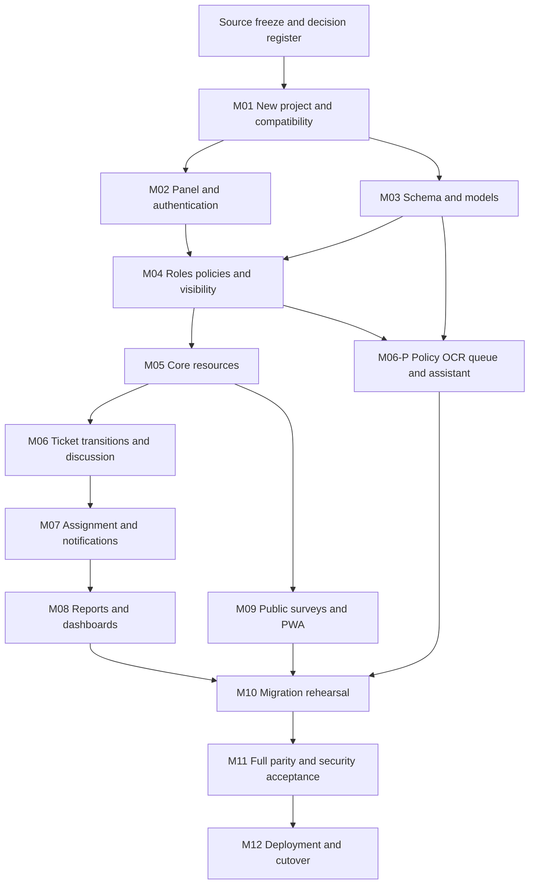

# 20 - Rebuild Implementation Roadmap and Readiness Assessment

Prepared **2026-10-28**. This is a future implementation roadmap. **No milestone is started or accepted by this documentation task.** It does not authorize scaffolding, dependency changes, data reads/imports, deployment or production cutover in the current repository.

## 1. Delivery controls

- Build in a separately approved new-project directory/repository with PHP8.5 and isolated MySQL. Never bootstrap over EmployeeCare or repurpose its production environment file.
- Freeze the chosen source working-tree revision, not just HEAD. Use [15 decisions](15-REBUILD-SPECIFICATION.md#6-decision-register-and-implementation-gates), [16 mapping](16-BACKPACK-TO-FILAMENT-MAPPING.md), [17 rules](17-BUSINESS-RULES.md), [18 migration](18-DATABASE-MIGRATION-PLAN.md) and [19 acceptance ledger](19-FUNCTIONAL-PARITY-CHECKLIST.md) together.
- Each milestone produces small reviewable code/config/schema/test artifacts in the **new** application, with passed applicable tests and recorded unresolved decisions. Default-status/permission/side-effect regressions are blockers, not cleanup work after launch.
- Unit/feature/security tests accompany every milestone. M11 is final regression/acceptance, not the first time tests are written. MySQL integration is required where locking/index/collation matters.
- Do not translate every model into generic CRUD. The public kiosk, file serving, ingestion, assistant, report PDF and transition flows require the explicit custom implementations in 16.

## 2. Milestone dependencies

Schema/resource/validation design can proceed in bounded branches after its decisions are settled. This diagram does not require deploying modules independently or adding services. Mandatory M06-P is a clearly tracked workstream inside the complete feature scope, not an optional future enhancement.

## M01 - New Laravel project setup and compatibility

**Dependencies:** approved separate project path; source baseline; target PHP/MySQL/build proposal from 15.

**Work:** provision PHP8.5/web/CLI/worker extensions; create latest stable Laravel13 skeleton in the new location; resolve Filament5/Livewire4/Spatie8 and candidate document packages from stable tags; retain stable minimum stability and lockfiles. Configure Blade/Tailwind4.1+/Vite and CI isolation. Review PDFParser/QR/Process dependency constraints, new framework defaults and chosen Node/plugin engines. Do not carry Backpack/PermissionManager, old CrudTrait, Mix/Livewire2 or legacy provider registration.

**Outputs:** new-app dependency decision/lock evidence, runtime/build configuration, CI smoke harness and fixture policy. No old secrets/employee seed data.

**Acceptance:** actual Composer resolution and check-platform-reqs under PHP8.5; current dependency advisory review with accepted disposition; production assets build; a minimal panel/public page renders; safe file/HTTP test doubles work. Official manifests establish declared compatibility only until this exit evidence exists.

**Blocking decisions:** final path/runtime provisioning, D03/D13/D14 for applicable package/browser choices. Supplemental package constraints that cannot resolve require explicit alternative selection, not platform-requirement bypass.

## M02 - Filament panel, authentication and account experience

**Dependencies:** M01; D02/D12/D16 for production auth behavior (isolated synthetic local implementation can precede external contract acceptance).

**Work:** shared /employee-care panel admission; custom email-or-username Login page; active session revocation; employee landing page; approved external integration/recovery/registration; profile/avatar/skills/password/preferences; last-login listener. Protect routes against unsafe redirects and GET logout. Preserve legitimate employee membership rather than applying administrator-only sample gate.

**Outputs:** authentication/account pages, integration adapter contract, synthetic old-bcrypt fixture tests and safe provisioning path.

**Acceptance:** FP-A01-A08/FP-B01 relevant cases pass; inactive direct/reactive access denied; credentials never logged/double-hashed; approved callback/logout/session behavior and public survey separation accepted. An external login redirect alone is not completed integration.

## M03 - MySQL schema, models and relationships

**Dependencies:** M01; D01/D03/D06 for final production/import mapping. A synthetic schema draft can proceed with documented assumptions.

**Work:** new Laravel13 migrations/models matching domain catalog in 18; semantic status configuration; casts/constraints/indexes; native JSON and long Unicode fields; distinct target infrastructure tables. Preserve custom status/permission/catalog possibilities. Compare old nullable/unenforced relationships with proposed stronger constraints; create explicit profiling/exception requirements.

**Outputs:** reviewed schema map/ER, model relationships, isolated fixture builders, versioned transformation specification. New migrations belong to new app only.

**Acceptance:** schema creates on empty isolated MySQL, named constraint/nullable-UUID/multiple-null/UTF8/JSON tests pass; dependencies/IDs valid; no source migration history falsely marked applied. No unapproved truncation/deduplication or cascade expansion.

## M04 - Roles, policies and access control

**Dependencies:** M02/M03; D04/D05/D11/D15/D16.

**Work:** Spatie8 web-guard mapping; fresh default grants versus actual imported grants; explicit resource/custom-operation policies and shared TicketVisibility query; missing-policy failure detection; scoped search/widgets/download/discussion; full role editor including ticket.assign. Define multi-role precedence and approved field-action intersections.

**Outputs:** policy matrix, shared queries/rules, grants migration fixtures and direct/reactive authorization tests.

**Acceptance:** FP-B01-B07 and relevant catalog/policy-manager cases pass. Noncreator admin cannot reopen, staff generic Edit remains denied, head deletion needs actual grant, direct/grant custom names survive no-op role save. No resource generator or navigation state substitutes for authorization. New bulk actions remain disabled.

## M05 - Core CRUD resources

**Dependencies:** M03/M04; D06/D15 for lifecycle/reference behavior.

**Work:** Department, Division, Issue, Priority, Status, User, Role and Permission resources; form/table/validation/relationship mapping from 16; cache invalidation, safe colors/JSON and referenced-deletion feedback. User hashing/password retention and active flags integrate M02. Resource tests cover actual backend fields and scope rather than snapshotting generator output.

**Outputs:** eight reference/identity resources, approved navigation and tests. Ticket and policy document resources are completed with their own workflows in M06/M06-P.

**Acceptance:** FP-C01-C07 pass on MySQL; duplicate/self-edit/relationship/role restrictions verified. Imported nullable/duplicate-name rows remain representable without hidden repair. No extra import/export/replicate/restore/bulk CRUD capability is enabled.

## M06 - Ticket workflow, files, discussion and reassignment

**Dependencies:** M05/M04; D04/D05/D06/D07/D09.

**Work:** TicketResource/create/edit/view and employee SubmitTicket Page; application actions for create/update/assign/resolve/reopen/request/accept/reject/cancel; explicit timestamp/side-effect invariants; deterministic reference generation; private attachment service and protected routes; Livewire4 discussion; locked parent/transfer transitions. Assignment/notification services from M07 can initially use defined test doubles; completion requires integrated M07 evidence.

**Outputs:** ticket/action model, shared validation, discussion, protected file responses, transfer history, failure/compensation handling and MySQL race tests.

**Acceptance:** FP-T01-T12, FP-X01-X03 and FP-F01-F06 pass as applicable; no forged field/state/record bypass; resolution/reopen/transfers preserve timestamps and files; parent lock prevents duplicate pending transition. All accepted differences in resolved assignment/edit boundaries/incoming list are recorded.

### Mandatory M06-P - Policy documents, ingestion and HR assistant

**Dependencies:** M03/M04/M01; D08/D09/D13/D14. This can proceed alongside ticket UI after the shared auth/storage contracts exist.

**Work:** tenth resource (policy documents) and upload/update actions; private PDFs; versioned dedicated database queue; native/OCR extraction/cache/chunking/quality gate; continuous worker recovery; retrieval/prompt/provider adapter; full-page/floating assistant; conversation/history/feedback/clear/delete; operator import/diagnostic tools. Preserve metadata-only edits, browser-versus-CLI semantics and source-grounded/no-provider-on-miss behavior.

**Outputs:** policy/chat rule tests, provider mock contract, nonsensitive native/scanned/mixed PDF samples, supervised-worker deployment specification and runtime recovery rehearsal.

**Acceptance:** FP-P01-P09 and FP-H01-H07 pass; stale jobs cannot overwrite replacement/deletion; low-confidence documents excluded; default force action validates before deletion; provider failures are not saved as policy answers; histories/private UI isolated. Real PHP8.5 PDF/OCR tests and approved provider/model smoke test are needed before final acceptance. A queue payload or mocked AI answer is not end-to-end completion.

## M07 - Notifications and automated assignment

**Dependencies:** M06/M04; D09/D15; M06-P supplies shared conventions but its finished UI is not a prerequisite.

**Work:** port active HR eligibility, skill normalization/+5, custom-issue load-only selection, Pending/Reopened workload and lowest-ID tie; one event/action path with original failure semantics. Implement database-only recipient/preference/actor/transfer rules, full legacy payload adapter, feed/list/read/clear and after-commit/transaction contract. No unrequested email/push/queue delivery behavior.

**Outputs:** deterministic selection service, notification selector/payload UI, event-order/duplicate tests, safe import-suppression mode.

**Acceptance:** FP-T05-T07 and FP-N01-N03 pass; creation/assignment notice ordering matches intended behavior, initial Pending not duplicated as status update, later updates notify, roles/actor/preference/default transfer flags correct. Import mode sends nothing and never reruns matching.

## M08 - Reports and dashboards

**Dependencies:** M06/M07/M04; D03/D06/D07/D11/D13/D14.

**Work:** current dashboard scope/employee redirect/periods/latest rows; six metric/dataset families; staff/catalog/division reports and satisfaction/ARTA history/aggregates/PDFs. Reproduce deliberate zero-activity/hidden-chart/page-size/cap behavior; use bounded queries and explicit Carbon3/MySQL compatibility math. Build print templates separately from panel Tailwind.

**Outputs:** approved golden datasets/formula ledger, query/performance tests, report pages/widgets, PDF visual samples and permission tests.

**Acceptance:** FP-R01-R08 pass, including empty/zero rows, exact rating strings, all transfer states, minute/hour boundaries, resolver-versus-assignee and 2000/2001 ARTA cap. PDF fonts/Unicode/layout approved and no inaccessible ticket affects dashboard. New-framework rounding/SQL differences are not waived by a new chart rendering correctly.

## M09 - Public surveys and PWA

**Dependencies:** M05/M03; D03/D06/D12/D13/D14. Develop public flows independently of reports once the catalog contract is stable.

**Work:** public /survey and /arta-form outside panel login; exact staff/service/CC/SQD validation, UUID idempotency/concurrency, JSON/form redirects/thank-you, fresh CSRF/two-tier limits, kiosk carousel/fullscreen/reset, approved QR destinations. Versioned allowlist worker strips tokens, caches only eligible public views and activates safely between respondents. No offline submission outbox or blanket panel cache.

**Outputs:** public views/components, client/worker assets, server/MySQL race tests and device/browser acceptance.

**Acceptance:** FP-S01-S06 and FP-Q01-Q03 pass; identical retry creates one row, changed payload fails, next respondent gets clean state/UUID, offline clearly requires reconnect, ARTA at least-one-SQD/CC N-A rules correct. Installed-worker/base-path migration and QR scanning tested on approved devices.

## M10 - Data migration and rehearsal

**Dependencies:** M03/M04 plus mature M02/M05/M06/M06-P/M07/M08/M09 paths for final rehearsal; D01/D02/D03/D09/D10/D15 resolved for actual source data use.

**Work:** build importer/manifest/checkpoints in new project, initially synthetic; obtain separately approved source snapshot; transform all tables/files/morphs/history/URLs with no business side effects; exercise restart/conflict/error ledger; classify runtime tokens/sessions/jobs and interrupted policy states. Rehearse writer freeze and final snapshot/delta including deletions.

**Outputs:** versioned mapping/importer, restricted counts/hash/exception evidence, repeatable reconciliation and rollback rehearsal package. No credentials/PII in repository test fixtures.

**Acceptance:** FP-O02/O03 and every applicable migration consideration in 19 pass; source count=accepted+explicit exceptions for every object; IDs/FKs/grants/content/times/files reconcile; no silently dropped row or guessed placeholder. All exceptions have owner disposition, and repeat import is idempotent without divergent overwrite. No live data operations are implied by this milestone description.

## M11 - Automated testing and security acceptance

**Dependencies:** all functional milestones including M06-P and M10 rehearsal. Tests already exist throughout; this is the integrated release gate.

**Work:** run new-stack unit/feature/Filament/Livewire/MySQL suites, direct-request and browser tests, role/multi-role matrix, concurrency/crash/failure injection, upload/privacy/cache/CSRF/rate tests, dependency audits and build; inspect long-running query/memory/worker behavior against agreed volume. Conduct complete old/new feature review with screenshots/PDF/QR samples and approved deviations.

**Outputs:** completed 83-rule parity ledger plus cross-feature gates, test/audit/build/browser reports, remaining risk acceptance and rejected/blocked cases. Historical old-app test results cannot substitute.

**Acceptance:** all required checks pass or a specific deviation is approved; SEC-01 through SEC-11 have evidence; no known unexplained regression or unaccounted migration loss. Agreed capacity is measured, not invented. D14 is settled before claiming any latency/concurrency target.

## M12 - Deployment, cutover and handover

**Dependencies:** M11 plus actual environment/integration owner sign-off, D10 and approved production action scope.

**Work:** provision HTTPS/trusted proxy/cookies/private storage/worker/tool/key settings, verify current PHP/web/CLI binaries, build assets and caches appropriate to new routes; test backups/restoration/monitoring; drain origin jobs and freeze ALL writers; final import/reconciliation; switch one write authority, refresh clients/sessions and activate target worker. Preserve old origin through rollback window.

**Outputs:** authorized runbook, exact releases/configuration references, backup/restore and migration evidence, smoke tests, monitoring/incident owner, administrator/user training and post-cutover reconciliation.

**Acceptance:** production controls are verified against actual host/base path; approved workflows operate; no old worker or public-file bypass remains; rollback before and after accepted target writes is rehearsed and bounded. Traffic switchback alone is not lossless rollback after writes. Source retirement/deletion is a later separately authorized task.

## 3. Readiness assessment and required developer decisions

| Area | Sufficient evidence now | Still required before dependent acceptance |
| --- | --- | --- |
| Functional scope | Controllers/services/models/routes/views/tests plus guides01-14 identify implemented modules | Owner acceptance of D04-D08/D11/D16 differences; actual browser/device expectations |
| Core stack | Official Laravel13/PHP8.5/Filament5/Livewire4/Spatie8 constraints permit target | Actual clean Composer solve/security audit/build and runtime tests on PHP8.5; PDF/OCR/QR accepted versions |
| Filament replacement | All10 CRUD modules/custom/public workflows mapped in16 | Working new components/actions/policies and tests; no automatic code conversion assumed |
| Database structure | All33 source migrations and26 declared tables documented | Current source metadata/custom objects/collation/counts/orphans/timezone and approved ID/exception map |
| Authentication/accounts | Local credential/active/role/guard logic and external redirect visible | External identity/session/recovery/provisioning contract; roleless/at-risk credentials policy |
| Business/report rules |83 BR/FP rules and formula boundary risks specified | Approved field/state/visibility/organization/SLA decisions and golden fixtures |
| Files/history | Storage roots/reference/compensation and lifecycle known | Actual protected manifests/classification/conflicts/missing files/retention disposition |
| Operations | Required queue/tool/runtime behaviors and safe runbook outline | Hosting/process manager/monitoring owners, RPO/RTO/backups/restoration and authorized cutover scope |

**Conclusion:** this is development-ready for bounded implementation planning and an independently authorized new-project foundation. It is **not** a closed specification for unreviewed production equivalence/cutover. Codex can reconstruct the documented modules using the six-file package; it must not invent missing SSO, data repairs, permission changes, report corrections or post-write rollback. Resolve the applicable D-ID before completing that milestone, record the choice in the BR/FP ledger, and proceed with unaffected approved work.

## 4. Documentation verification for this task

The final verification record below is filled after checking all six files. Application/runtime acceptance tests are not executed for documentation-only changes. Existing source/dependency/configuration/migration/test/file content is hash-compared with the task-start baseline; only the six requested specifications and documentation index are intended changes. Old reports remain historical and are not restamped as fresh test results.

### Completed documentation checks - 2026-10-28

| Check | Executed result |
| --- | --- |
| Required deliverables | All six requested specification files exist and documentation index links them |
| Internal/source links and heading fragments | 457 local references across six specifications plus index; zero missing targets/anchors |
| Rule/checklist integrity | 83 unique BR identifiers, 83 matching FP identifiers; no missing/duplicate rule pair |
| Roadmap completeness | All 12 requested milestone headings present; mandatory policy/OCR/chat workstream explicitly included |
| Markdown/diagram source | Balanced code fences; roadmap Mermaid node/edge structure reviewed; visual rendering Not Verified |
| Existing-file hash comparison | 330 existing baseline files compared; only docs/README.md changed. Application/config/routes/migrations/tests/dependency files in that baseline unchanged |
| Added files | Exactly six new requested specification files; no app scaffold, importer, migration or package created |
| Diff whitespace | git diff --check passed; preexisting MEDIUM_FIXES line-ending warning only |
| Official research | Official documentation and tagged manifests checked for core stack; optional runtime integration evidence remains gated |
| Application tests / dependency solve / DB operations | Not run for this documentation task; no current-app/new-app test pass, runtime package solve, database access or migration claimed |

Validation distinguishes static specification completeness from implemented feature parity. No FP checkbox is marked complete by these documentation checks. The remaining owner/developer decisions are the D01-D16 register, not silently assumed requirements.
