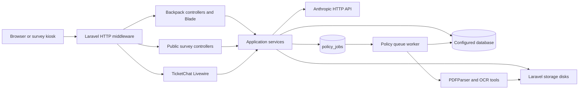
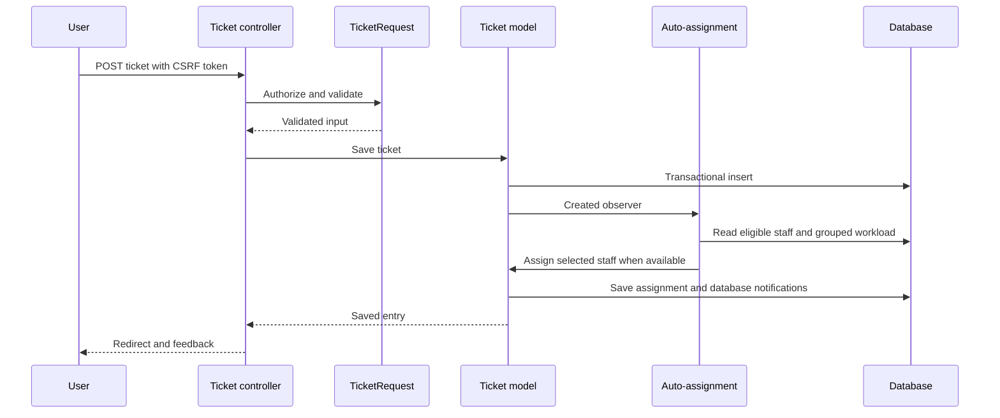
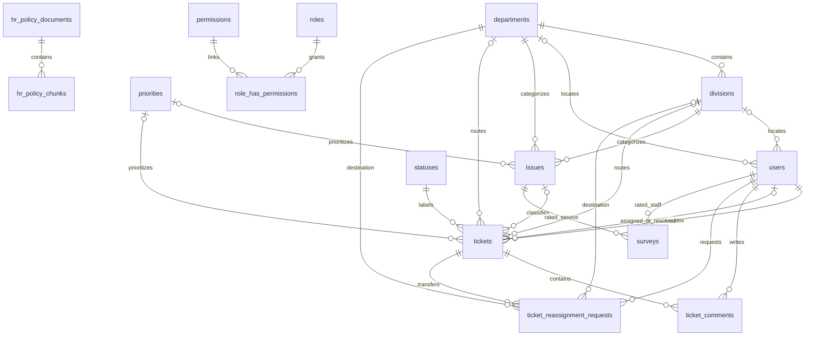
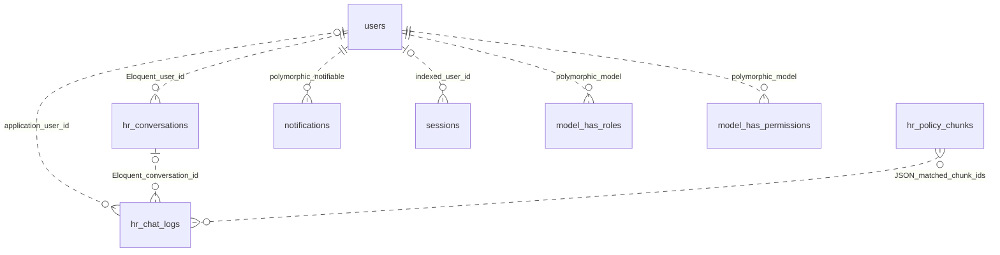
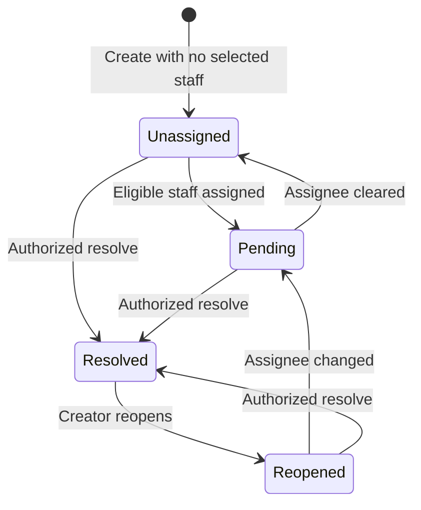
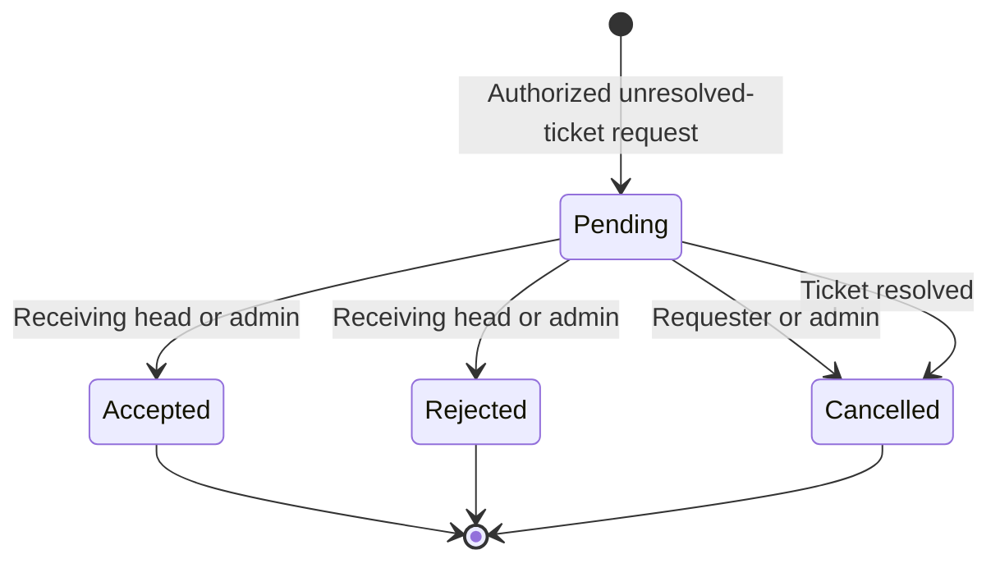
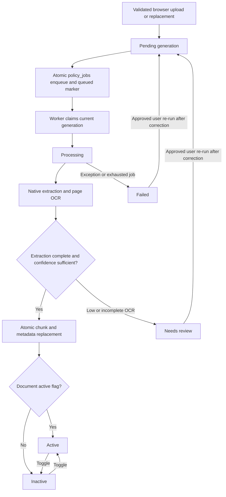
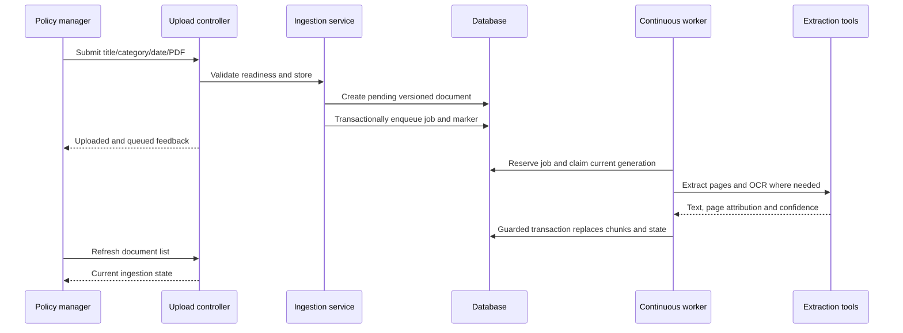

# Consolidated System Diagrams

Diagrams describe current source behavior, not deployed infrastructure. The architecture/ER blocks below are collected from guides 02/03; keep them synchronized when changing those canonical descriptions. Dotted ER edges mean application references without database FKs. Browser rendering/export was not performed; structural validation and source review are recorded in the coverage report.

## 02 diagram 1
Context and evidence: [02-SYSTEM-ARCHITECTURE.md](02-SYSTEM-ARCHITECTURE.md).



## 02 diagram 2
Context and evidence: [02-SYSTEM-ARCHITECTURE.md](02-SYSTEM-ARCHITECTURE.md).



## 03 diagram 1
Context and evidence: [03-DATABASE-DOCUMENTATION.md](03-DATABASE-DOCUMENTATION.md).



## 03 diagram 2
Context and evidence: [03-DATABASE-DOCUMENTATION.md](03-DATABASE-DOCUMENTATION.md).



## Ticket status workflow

Source: [Ticket model](../app/Models/Ticket.php), [controller](../app/Http/Controllers/Admin/TicketCrudController.php), [assignment service](../app/Services/TicketAutoAssignmentService.php). This shows the principal workflow; head/admin generic status editing can introduce additional configured transitions.



Deadline calculations use original creation time. No escalation transition or scheduled escalation worker is represented because none was found.

## Reassignment request lifecycle

Source: [controller transition handlers](../app/Http/Controllers/Admin/TicketCrudController.php), [request model](../app/Models/TicketReassignmentRequest.php).



Acceptance changes location and reruns staff assignment; request status and ticket status are separate fields. Parent/pending rows are locked for transitions.

## Policy ingestion states

Source: [ingestion service](../app/Services/PolicyIngestService.php), [job](../app/Jobs/IngestPolicyDocumentJob.php), [queue config](../config/queue.php).



Needs-review chunk/metadata updates are also transactional. Retrieval excludes pending/processing/failed/needs_review/inactive documents. Effective date is not an eligibility predicate. Re-run is not a quality-override approval action.

## Policy upload sequence



A saved document can remain pending if dispatch fails or no worker runs. Generation guards discard stale jobs after replacement; deletion is not prohibited by the service's processing edit guard.

## Survey submission and retry

Source: [survey browser script](../public/survey-assets/js/survey.js), [controller](../app/Http/Controllers/SurveyController.php), [submission service](../app/Services/SurveySubmission.php), [worker](../public/sw-survey.js).

```mermaid
sequenceDiagram
    participant K as Kiosk browser
    participant SW as Service worker
    participant C as Survey controller
    participant D as Database
    K->>SW: GET survey page/assets
    alt Network available
        SW->>C: Fetch current public survey
        C-->>SW: Eligible cacheable HTML
        SW-->>K: Network response; cache sanitized copy
    else Network unavailable
        SW-->>K: Cached public view or offline fallback
        Note over K: Reconnect before submitting; no offline outbox
    end
    K->>C: GET current CSRF token
    C-->>K: Session token with no-store
    K->>C: POST answers with stable submission UUID
    C->>D: Validate and firstOrCreate UUID in transaction
    D-->>C: Existing identical response or new row
    C-->>K: Saved confirmation
    Note over K: Retry retains UUID; next respondent gets a new UUID
```

Reusing the same UUID with changed answers fails validation; the database unique constraint resolves races. ARTA uses the shared persistence service but follows ordinary form redirects, not the same explicit JSON submission contract.

